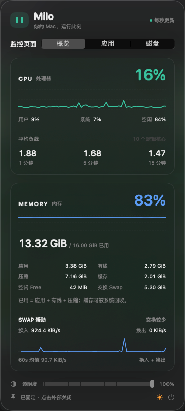
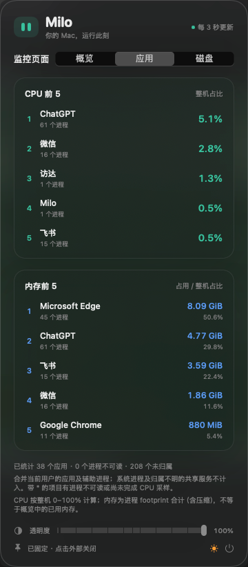
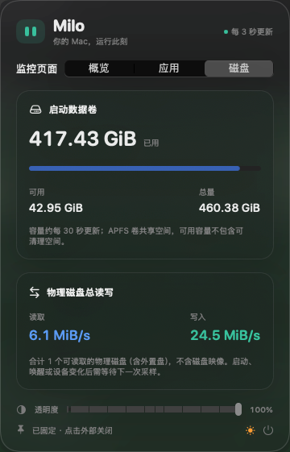

# Milo

你的 Mac，运行此刻。

Milo 是一个常驻 macOS 菜单栏的小工具。抬眼就能看到 CPU 和内存用了多少，鼠标停上去，还能看看哪些应用最占资源、磁盘还剩多少空间。

**[下载 Milo](https://github.com/The-V-Factor/Milo/releases/latest)** · [查看更新](https://github.com/The-V-Factor/Milo/releases)

支持 macOS 14 及以上，同时兼容 Apple Silicon 和 Intel。

## 能看什么

- **概览**：CPU、内存、平均负载，以及内存与磁盘交换的速度和趋势。
- **应用**：CPU 和内存占用各前 5 名，合并可识别的辅助进程。
- **磁盘**：总容量、已用和可用空间，以及当前读取、写入速度。

还可以调节面板透明度，切换日间／夜间样式。

## 预览

<table>
  <tr>
    <th>概览</th>
    <th>应用</th>
    <th>磁盘</th>
  </tr>
  <tr>
    <td valign="top"></td>
    <td valign="top"></td>
    <td valign="top"></td>
  </tr>
</table>

## 安装

1. 打开 [下载页面](https://github.com/The-V-Factor/Milo/releases/latest)，在 **Assets（附件）** 中下载 `.dmg` 文件。
2. 打开 DMG，把 **Milo** 拖进 **Applications（应用程序）**。
3. 从“应用程序”打开 Milo，菜单栏就会出现 CPU 和内存数据。更新前请先退出旧版。

Milo 免费开源，未经过 Apple 公证。如果首次打开被 macOS 拦截，请先确认下载来源，再按照 [Apple 的说明](https://support.apple.com/zh-cn/102445) 在“系统设置 → 隐私与安全性”中选择“仍要打开”。

## 怎么用

- **看详情**：鼠标停在菜单栏数据上，展开面板；移开后自动收起。
- **固定面板**：点击菜单栏数据。点击外部或按 Esc 关闭。
- **切换内容**：点击顶部的“概览”“应用”或“磁盘”。
- **调整外观**：拖动底部透明度滑杆，点击太阳／月亮切换样式；设置会自动保存。
- **退出**：点击面板右下角的电源按钮。

刚打开时，部分速度和趋势需要等几秒才会出现；Swap 活动提示需要累计约一分钟。磁盘容量不包含潜在可清理空间，应用排行榜也可能无法计入部分系统共享服务。

Milo 不上传监控数据，历史趋势只保留在内存中，无需辅助功能或录屏权限。

## 想了解更多

- [指标说明](docs/metrics.md)：各项数据代表什么、为什么可能与“活动监视器”不同。
- [开发与发布](docs/development.md)：从源码运行、测试和打包。
- [反馈问题或建议](https://github.com/The-V-Factor/Milo/issues)。
